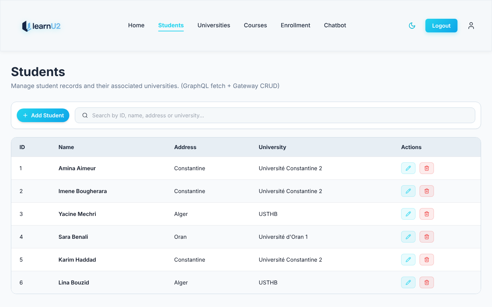
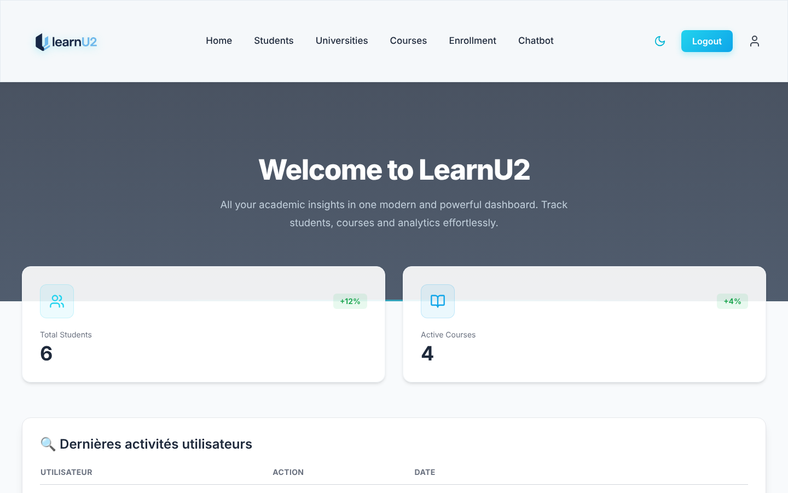
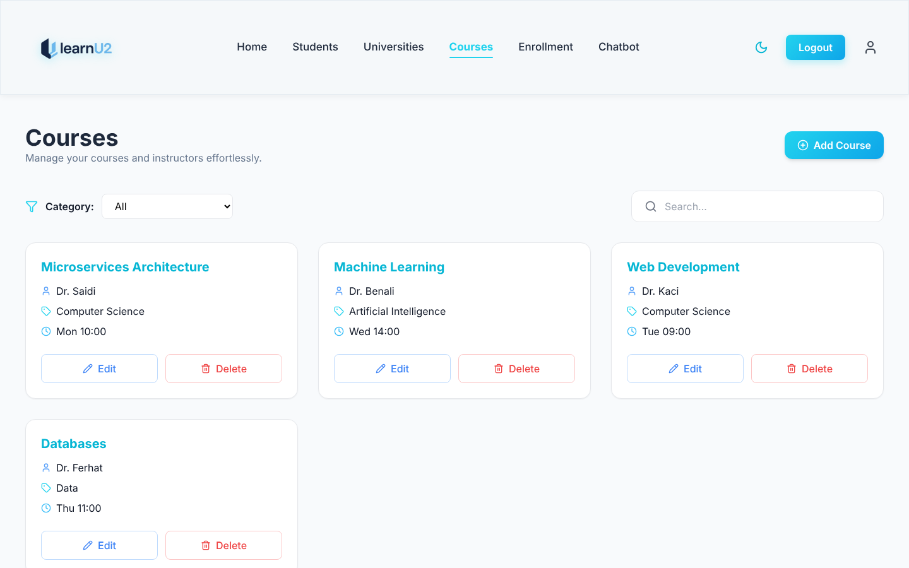
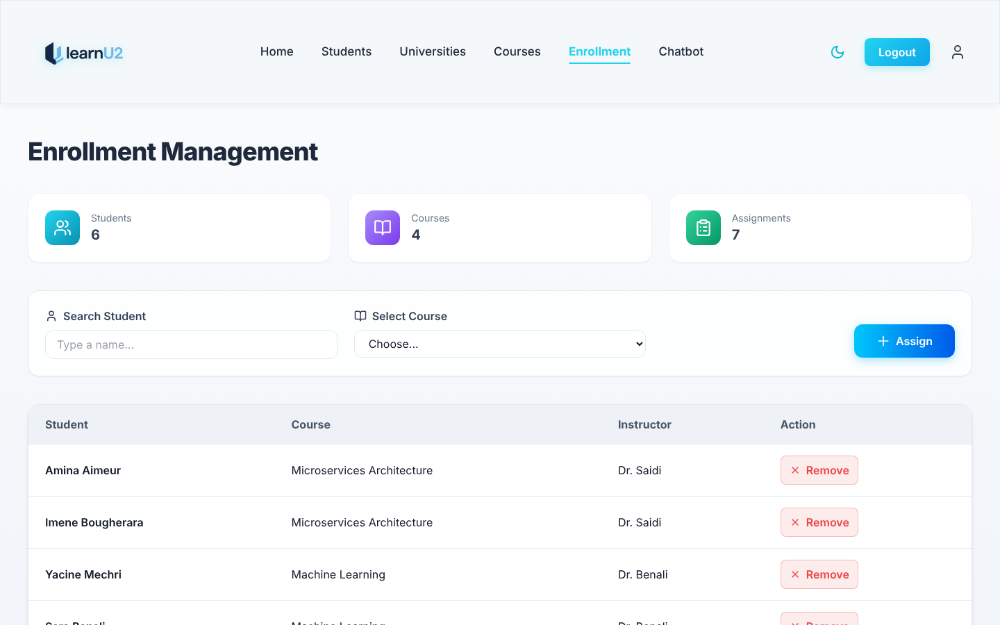
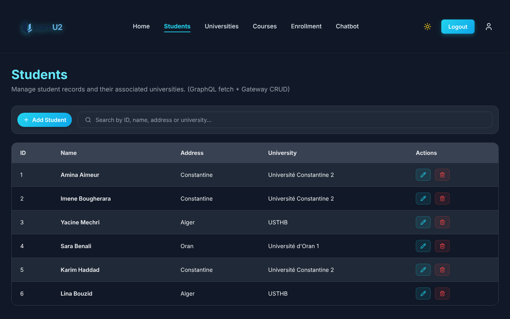

# LearnU: campus management platform built with microservices

A university dashboard to manage students, universities, courses and enrollments, with an activity history and an AI assistant that translates and summarises text. Each feature is its own microservice, written in Java (Spring Boot) or Python (Django), behind a single API gateway.



## Features

- **Students and universities:** create, edit, search and delete, with each student linked to a university (Spring Boot + PostgreSQL).
- **Courses and enrollments:** course catalogue with categories and schedules, and enrollment of students in courses (Django REST Framework). A student cannot be enrolled twice in the same course.
- **GraphQL API:** one query combines data from the course and student services, for example a course with its enrolled students.
- **Activity history:** every successful create, update and delete is recorded by the gateway and shown on the dashboard.
- **AI assistant:** French ↔ English translation and summaries with Hugging Face Transformers (MarianMT and mT5).
- **Accounts:** registration, login with username or email, JWT authentication, password rules, and a dark theme saved per account.

## Architecture

```
                 browser (React + TypeScript, :5173)
                              │
             API gateway (Spring Cloud Gateway, :8083)
             · checks the JWT on every request
             · forwards the caller's identity to the services
             · records every write in the activity service
                              │
  ┌────────────┬──────────────┼─────────────┬──────────────┬──────────────┐
  auth         students       courses       GraphQL        activity       chatbot (AI)
  Django       Spring Boot    Django        Django +       Spring Boot    Django +
  + JWT                       REST          Strawberry                    Transformers
```

- **Database per service:** auth, students, courses and activity each have their own PostgreSQL database.
- **Single entry point:** only the frontend and the gateway are published. The services live on the internal Docker network, so nothing reaches them without going through the gateway's JWT check.
- **Stateless authentication:** the auth service signs HS256 tokens and the gateway verifies them with the same `JWT_SECRET`, without calling the auth service on each request.

| Service | Folder | Stack |
| --- | --- | --- |
| Frontend | [`learnu2`](learnu2) | React, TypeScript, Vite, Tailwind CSS, Radix UI |
| API gateway | [`gateway/gateway`](gateway/gateway) | Spring Cloud Gateway (WebFlux), Java 17 |
| Auth | [`auth_service`](auth_service) | Django, Django REST Framework, Simple JWT |
| Students | [`studentservice`](studentservice) | Spring Boot, Spring Data JPA |
| Courses | [`course-service`](course-service) | Django REST Framework, django-filter |
| GraphQL | [`graphql_gateway`](graphql_gateway) | Django, Strawberry GraphQL |
| Activity | [`activityservice`](activityservice) | Spring Boot, Spring Data JPA |
| AI assistant | [`chatbot`](chatbot) | Django, Hugging Face Transformers, PyTorch |

## Screenshots

| Dashboard | Courses |
| --- | --- |
|  |  |

| Enrollments | Dark theme |
| --- | --- |
|  |  |

## Getting started

### Requirements

[Docker Desktop](https://www.docker.com/products/docker-desktop/) is all you need.

### Run

```bash
cp .env.example .env          # Windows: copy .env.example .env
# edit .env and replace every "change-me" value (JWT_SECRET: at least 32 characters)
docker compose up --build
```

Open http://localhost:5173 and create an account. The first build takes a few minutes.

The AI assistant is heavy (PyTorch plus about 2 GB of models downloaded on first use), so it only starts when asked:

```bash
docker compose --profile ai up --build
```

### Tests

```bash
# Python services (from each service folder)
python manage.py test

# API gateway (JWT verification)
cd gateway/gateway && ./mvnw test
```

## Security

- **Token check at the gateway:** every request needs a valid access token, except login and registration. Expired tokens, refresh tokens, wrong signatures and `alg: none` tokens are rejected.
- **No forged identity:** the gateway removes any `X-User-*` header sent by the browser before adding its own.
- **Server-side activity log:** the activity log is written by the gateway only, and `/activity/add` is blocked from outside, so users cannot forge entries.
- **No secrets in the code:** every password and key comes from environment variables (see the `.env.example` files).

## My role

LearnU was built as a team project during a university course, with each person taking a service from back end to front end. My contributions:

- **Student service** (Spring Boot): student and university CRUD.
- **AI assistant** (Django + Transformers): translation, adaptive summaries and language detection.
- **Frontend** (React + TypeScript): most of the pages and their connection to the APIs.
- **Auth service, activity service, gateway configuration, Dockerfiles and the first deployment on Render.**

Teammate [bougheraraimene](https://github.com/bougheraraimene) built the course service, deployed the GraphQL gateway and added the chatbot page.

After the course, I reworked the project in this repository:
- **One-command launch:** Docker Compose for the whole platform, with all URLs moved to environment variables.
- **Security:** JWT verification at the gateway, and an activity log the browser cannot write.
- **Bug fixes:** login case, settings that were never saved, duplicate enrollments, enrollments kept only in the browser, missing 404 errors, and GraphQL N+1 calls.
- **Cleanup and tests:** dead code removed, and tests added.

## Roadmap

- Roles (admin / student) so that only admins can delete data or clear the activity log.
- Integration tests running the whole stack in CI.
- Deploy a public demo.
